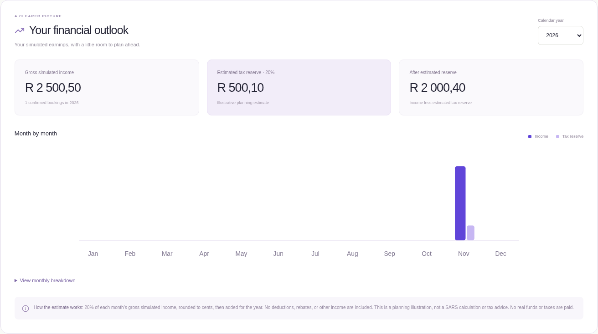

# HustleHub+ — Secure marketplace, financial insights, and DevSecOps

HustleHub+ connects clients with freelance talent. The React application supports registration, login, gig discovery, simulated bookings, transaction history, and freelancer financial insights. The Express API enforces authentication, roles, ownership, financial attribution, and input validation independently of the interface.

This is a **single-API-process deployment reference** with simulated payments and a documented tax planning model. It includes automated checks, separate API and frontend containers, persistent state, structured audit logs, protected Prometheus metrics, and deployment smoke tests. Validation evidence and remaining production considerations are documented below.

## Features and roles

- Guests can browse published gigs, search services, filter categories, and register as a client or freelancer.
- Freelancers can create, privately view, edit, pause, and delete **their own** services. Gigs have a title, description, category, integer-cent ZAR price, and delivery period.
- Clients confirm a simulated booking. The server assigns the participants and price and commits the booking and transaction together. No payment information is collected.
- Each client/freelancer can read only bookings and transactions in which they participate. Freelancer income comes from transactions attributed to that freelancer.
- Confirmations use client-scoped idempotency keys. Concurrent retries return the existing booking and transaction instead of double-counting income.
- Updating or removing a listing preserves historic prices, transactions, and income.
- Freelancers have a calendar-year financial dashboard: gross income, estimated tax reserve, estimated amount after reserve, monthly bars, and an accessible exact-value table.
- Server-side logout revokes all account sessions. Persistent account lockout supplements IP and account rate limits.

**All income, payments, and tax reserves are simulated.** Messaging, cancellation/refund workflows, account recovery, real payment settlement, and admin management screens are not implemented. Admin cannot self-register and has no ownership bypass.

## Financial insights and tax estimate

`GET /api/financial-insights?year=2026` requires a freelancer JWT. The server filters transactions using the authenticated freelancer's ID and UTC calendar year. A caller cannot supply another owner ID. The workspace's existing income card shows lifetime income; the financial panel shows only the selected year.

The planning model is intentionally transparent:

1. Group the freelancer's recorded gross transaction amounts by UTC calendar month, using integer cents.
2. Estimate a reserve of **20% of each month's gross income**, rounded to the nearest cent with integer arithmetic: `(incomeCents × 20 + 50) / 100`, using integer division.
3. Add the 12 monthly reserves to get the annual estimate. Annual income and after-reserve totals are also sums of the monthly values, so the chart and table reconcile exactly.
4. After-reserve amount = gross simulated income − estimated reserve.

Example: **R 2 500,50** income in one month → **R 500,10** reserve → **R 2 000,40** after reserve. Zero income produces zero tax and 12 zero-value months. There is no annualisation, deductions, rebates, other income, age adjustment, or progressive bracket calculation. This is an **illustrative planning estimate, not a statutory SARS calculation or tax advice**. The UI explains this alongside the chart.



## Local development

Requirements: **Node.js 24+**, npm, and OpenSSL. Docker Engine with Compose v2 is needed for the container workflow. No external database, payment account, or external application API key is needed.

In this managed cloud environment, use `export NPM_CONFIG_CACHE=/workspace/.npm-cache` if the home directory is read-only. Ordinary local machines can use npm's default cache.

From the repository root:

```bash
npm ci
npm run setup
npm run dev
```

`setup` installs backend/frontend dependencies from lockfiles, creates an ignored `backend/.env` with a random development signing secret if no `.env` or injected secret exists, and generates a localhost TLS certificate if both TLS files are absent. It preserves existing local configuration. An incomplete certificate pair causes an explicit error.

Open **https://localhost:5173** after trusting the generated local certificate in your development browser. The HTTPS API uses port 8443 and Vite verifies and proxies `/api`. Separate terminals can run:

```bash
npm run dev --prefix backend
npm run dev --prefix frontend
```

For a single-process production-style application without Docker:

```bash
npm run build
npm start
# https://localhost:8443
```

`build` produces a checked backend distribution in `backend/dist/` and the compiled React app in `frontend/dist/`. The API build copies no `.env`, TLS keys, tests, or runtime data. `npm start` uses the source API and serves the built frontend from the same origin; the API container runs the built backend distribution. Stop an existing listener before starting another process on its port.

To demonstrate the workflow, register a freelancer and create a published gig. In a separate tab/context, register a client and book it. Return to the freelancer workspace to see the booking, income, and tax reserve. A fresh deployment starts empty; there are no default account passwords.

### Configuration and TLS

See [`backend/.env.example`](backend/.env.example). Exported values override `.env`; file-based secrets take precedence over raw secret variables. Do not copy the example's signing-secret placeholder unchanged: startup rejects it.

| Variable                                                 | Default / behavior                                                                    |
| -------------------------------------------------------- | ------------------------------------------------------------------------------------- |
| `JWT_SECRET` / `JWT_SECRET_FILE`                         | Required random secret, 32+ characters; Compose uses a file                           |
| `MONITORING_TOKEN` / `MONITORING_TOKEN_FILE`             | Independent 32+ character machine credential for `/metrics`; optional locally         |
| `NODE_ENV`                                               | `development`; containers use `production` for JSON logs                              |
| `PORT`                                                   | `8443`                                                                                |
| `JWT_EXPIRES_IN`, `JWT_ISSUER`                           | `1h`, `hustlehub-plus-api`                                                            |
| `HTTPS_KEY_PATH`, `HTTPS_CERT_PATH`                      | `./certs/key.pem`, `./certs/cert.pem`, relative to backend working directory          |
| `USER_STORE_PATH`, `MARKETPLACE_STORE_PATH`              | Ignored `./src/data/users.json`, `./src/data/marketplace.json`; Compose uses `/data/` |
| `CORS_ORIGIN`                                            | `https://localhost:5173`; comma-separated explicit origins                            |
| `BCRYPT_SALT_ROUNDS`                                     | `12`; isolated automated tests use `4`                                                |
| `AUTH_RATE_LIMIT_MAX`, `AUTH_RATE_LIMIT_WINDOW_MS`       | 10 login/register requests per IP per 900000 ms                                       |
| `BOOKING_RATE_LIMIT_MAX`, `BOOKING_RATE_LIMIT_WINDOW_MS` | 20 booking requests per user per 900000 ms                                            |
| `TRUST_PROXY_HOPS`                                       | `0` by default; Compose explicitly trusts one private ingress hop                     |
| `WEB_PORT`                                               | Compose's loopback HTTPS publication defaults to `9444`                               |

Vite reads the backend's configured port and TLS paths. `API_TARGET` can override its HTTPS API target. The development proxy retains Node/system/extra CA trust and trusts the configured self-signed localhost certificate. For a private signing CA, export `API_CA_PATH=/absolute/path/to/root-ca.pem` before `npm run dev`. In PowerShell use `$env:API_CA_PATH = 'C:\certs\root-ca.pem'`. Restart both services after changing certificates. Never set `secure: false`, disable npm TLS verification, or use `NODE_TLS_REJECT_UNAUTHORIZED=0`.

## Docker Compose deployment

The stack has two separate containers:

- **api:** built Node API, non-root `node` user, HTTPS on the private container network, one named data volume, and `/api/ready` health check.
- **web:** non-root Nginx serves the compiled React app over HTTPS and proxies `/api/` to the API with certificate and hostname verification. Only its loopback-bound HTTPS port is published. Its HTTP health listener is internal and serves no application data.

Both images use digest-pinned bases, read-only root filesystems, dropped Linux capabilities, `no-new-privileges`, an init process, restart policies, and bounded log rotation. API secrets are mounted as files and excluded from build contexts/layers. The Dockerfiles install with `npm ci` and retain TLS verification.

```bash
node scripts/container-setup.cjs
# Creates ignored local-only signing/monitoring secrets and stages the TLS pair.
docker compose build
docker compose up -d --wait
# Open https://localhost:9444 after trusting the local certificate.
npm run test:containers

docker compose ps
docker compose logs --tail 30 api web
docker compose down
```

`container-setup` preserves existing signing/monitoring credentials and stages copies of the selected local certificate pair into `.secrets/`. The enclosing directory is `0700`. Staged files are readable by the different non-root container UIDs; they are not credentials committed to the repository. Use your deployment's secret manager and trusted certificate chain outside the local demonstration. Regenerating/staging TLS material requires restarting both containers.

The named `api-data` volume survives container recreation and process restarts. **Do not use `docker compose down --volumes` on valuable data**; it removes the volume. CI uses this only for its disposable runner. Do not run multiple API replicas against one JSON volume.

The Nginx ingress overwrites `X-Forwarded-For`; Compose's API trusts exactly that one hop and is not exposed on a host port. Keep that network boundary if using this setting. The default host port is loopback-only; production ingress, DNS, trusted TLS, backup policies, and monitoring access must be configured for the actual deployment.

Managed cloud builds need the inherited HTTPS proxy's CA as a **build secret**, not a copied image layer:

```bash
docker compose -f compose.yaml -f compose.cloud.yaml build
```

The provided `CODEX_PROXY_CERT` supplies that CA. Standard local/CI builds use `docker compose build`. The web health check disables proxy use only for its own `127.0.0.1` health listener; external downloads continue through configured proxies with verification.

`API_IMAGE` and `WEB_IMAGE` can select previously published images. To deploy them without rebuilding, set the variables to the desired SHA-tagged registry images and run `docker compose up -d --no-build --wait` with deployment-specific secrets and certificates.

## CI/CD and static analysis

[`.github/workflows/test.yml`](.github/workflows/test.yml) runs automatically for pushes and pull requests, and supports manual dispatch. It has read-only repository permissions by default, bounded job durations, and cancellation of superseded checks.

1. **validate:** install locked dependencies and local TLS; run static analysis; run backend, React, and TLS tests; execute Newman; build **both** applications; audit production dependency trees at high severity; run Chromium workflows. Any nonzero exit fails the job. Reports and build/test artifacts are uploaded even on failure.
2. **containers:** requires validation success. Build both images, start Compose with health checks, exercise the real HTTPS stack, verify non-root/read-only containers, and check persistence across an API restart. Retain logs/state, then remove only the disposable CI stack.
3. **publish:** runs only for a push to `main` after both earlier jobs pass. Use the workflow-scoped `GITHUB_TOKEN` to publish SHA-tagged API and web images to GHCR with provenance and SBOM attestations. Pull requests and feature branches cannot publish images. There is no unconfigured automatic deployment to a live server.

Published image names are `ghcr.io/<lower-case owner/repository>-api:<commit-sha>` and `...-web:<commit-sha>`. GHCR package permissions must allow the repository workflow to publish. No registry password belongs in the repository.

### Static-analysis evidence

```bash
npm run lint
```

This runs **ESLint 10** with recommended JavaScript rules, React Hooks rules, and selected security checks for unsafe regexes, dynamic evaluation, implied evaluation, prototype access, unsafe buffers, and insecure random-byte APIs. Warnings fail the check as well as errors. A single documented control-regex allowance permits intentional removal of non-printing input characters.

The actual JSON results and summary are retained under `reports/` and uploaded by CI. A checked-in validation snapshot is in [`docs/evidence/`](docs/evidence/). The summary is also written to the GitHub job summary. The chat handoff reports the measured file/error/warning counts.

A clean result means no violations of these **configured rules** were detected in the analysed sources. It does not prove that all security vulnerabilities are absent; the access-control, financial integrity, TLS, and runtime checks provide separate evidence.

## Logging, monitoring, and operations

Production API logs are structured JSON on stdout. Nginx emits structured JSON request logs. Docker rotates each service's logs at 10 MB with three retained files. Do not put logs in the writable application data volume.

| Event                                                      | Captured fields and monitoring purpose                                                                             |
| ---------------------------------------------------------- | ------------------------------------------------------------------------------------------------------------------ |
| `auth.registered`                                          | User ID and role; account creation audit                                                                           |
| `auth.login_succeeded`, `auth.login_failed`, `auth.locked` | User ID when known, outcome, request ID; brute-force detection and incident correlation                            |
| `auth.sessions_revoked`                                    | User ID and request ID; server-side sign-out audit                                                                 |
| `booking.confirmed`, `booking.replayed`                    | Booking/transaction and participant IDs, request ID; distinguish new confirmations from retries                    |
| `transaction.created`                                      | Linked transaction/booking and participant IDs; financial attribution audit without logging amounts or credentials |
| `access.denied`, `request.rejected`, `error.internal`      | Outcome/status and request ID; authorization failures, malformed requests, and server errors                       |
| `http.request`, `web.request`                              | Method, path without query strings, status, duration, correlation ID; traffic/error/latency monitoring             |
| `server.draining`                                          | Signal; controlled shutdown visibility                                                                             |

The server generates `X-Request-ID` rather than accepting spoofed IDs. Audit metadata uses an allowlist. Passwords, hashes, bearer tokens, signing secrets, monitoring credentials, cookies, API keys, and email fields are redacted at the top level and recursively. Request bodies, authorization headers, raw email addresses, and financial amounts are not logged. Client error responses never contain stack traces or secret values. User IDs are pseudonymous identifiers and still require appropriate access and retention controls.

Public `GET /api/health` is a liveness check. `GET /api/ready` verifies readable/valid state and accessible writable store directories, returning 503 with no internals on failure. HTTPS header/request/keep-alive timeouts bound slow requests; SIGTERM/SIGINT stop accepting requests and drain active work with a 10-second bound.

### Protected metrics and alerts

`GET /metrics` is an **internal machine endpoint**, not a freelancer/admin screen. It requires its own strong bearer credential from `MONITORING_TOKEN_FILE` or `MONITORING_TOKEN`. Missing/invalid credentials return 401; if monitoring is not configured it returns 503. Comparison uses constant-size digests and a timing-safe comparison. The web ingress blocks this endpoint and the API has no public host port.

Metrics include process/memory/event-loop observations, HTTP request counts, duration histograms, and fixed-name audit event counters. Labels contain only bounded HTTP methods, status classes, and server-defined event names: no user IDs, emails, tokens, request IDs, gig titles, or arbitrary paths. In-memory metrics reset on process restart; persistent user state and revocation do not.

[`deploy/prometheus.yml`](deploy/prometheus.yml) and [`deploy/alerts.yml`](deploy/alerts.yml) provide operator scrape/alert configuration with verified TLS and a file-mounted bearer credential. Mount these together into your private Prometheus deployment. Alerts cover a failed scrape, a sustained server-error ratio above 5%, and repeated lockouts. Sending alerts and deploying an external monitoring service remain operator configuration; no notification destination is hard-coded.

To inspect local service logs:

```bash
docker compose logs --since 10m api web
```

Investigate a 5xx/failed readiness probe by correlating its request ID with API logs and storage health. Repeated `auth.locked`/denied events warrant credential-abuse investigation. Back up the persistent volume and forward production logs to a protected off-host log store; local rotated logs alone are not tamper-proof evidence.

## Additional security features

1. **Persistent account lockout:** five failed credential checks in a 15-minute window lock that account for 15 minutes, even across process restarts and requests from different IPs. Successful authentication resets failures when the account is not locked. Lockout also increments the token version, invalidating existing sessions. Responses remain the same generic 401 for locked accounts, unknown users, and wrong passwords; a dummy password hash reduces the unknown-account timing difference. This is separate from IP throttling and has tests for expiry and account isolation.
2. **Persistent server-side logout revocation:** `POST /api/auth/logout` increments the user's stored token version. Every protected API request verifies the JWT version against current persisted state, so **all** previously issued account tokens are rejected immediately, including after an API restart. New login issues a usable version. The UI clears its session after successful revocation; a network failure leaves a retry message instead of pretending revocation succeeded. Refreshing/closing a tab alone does not perform server logout; token expiry remains the fallback.
3. **Operational hardening:** separate monitoring credentials, request-ID correlation, private API ingress, file-mounted secrets, non-root/read-only containers, dropped capabilities, process timeouts, and bounded graceful shutdown supplement application controls.

## Final security review

| Threat                                     | Controls implemented                                                                                                                                                    | Evidence / residual considerations                                                                                                                                                                                    |
| ------------------------------------------ | ----------------------------------------------------------------------------------------------------------------------------------------------------------------------- | --------------------------------------------------------------------------------------------------------------------------------------------------------------------------------------------------------------------- |
| Injection and mass assignment              | Allowlisted JSON fields, strict primitive types, bounded lengths/integers, UUIDs, literal search, fixed server-owned participants/prices                                | Backend/Postman reject object payloads, price/owner injection, and extra fields. No user-controlled database query or executable template exists.                                                                     |
| Cross-site scripting and clickjacking      | Reject HTML input, trim/control sanitization, React text escaping, CSP without inline scripts/eval, no frames/objects/base URI                                          | Component test renders injected text inertly; browser workflow uses the deployment CSP. No `dangerouslySetInnerHTML`.                                                                                                 |
| Authentication weaknesses                  | Random signing secrets, HTTPS, bcrypt cost 12 and 72-byte cap, fixed HS256/issuer/expiry, current persisted role/version checks, generic failures, lockout, revocation  | Tests cover expired/forged/wrong-algorithm/stale-version tokens, lockout, fresh login, and restart persistence. Real account recovery/MFA is not implemented.                                                         |
| Broken access control / IDOR               | Owner checks for management; participant checks for bookings/transactions; own-user income and financial queries                                                        | Integration, Newman, and container checks deny cross-account reads/edits/deletes. Public published gig information is intentionally browseable; paused gigs are private.                                              |
| Financial tampering and duplicate requests | Server-derived price/participants, integer cents, serialized atomic booking/transaction commits, client-scoped idempotency                                              | Concurrent tests create one booking/income entry. Historical snapshots survive price changes and deletion. Simulated values are not settled funds or legal tax liabilities.                                           |
| Credential and information leakage         | In-memory browser JWTs, no-store API responses, secret files, audit allowlists/redaction, generic 500s, private metrics                                                 | Tests verify top-level/nested redaction and protected metrics. JWTs present in application memory still require XSS prevention. Local secret-file permissions are a development mechanism, not an encrypted vault.    |
| Brute force and resource abuse             | IP/account rate limits, persistent account lockout, 10 KB body limit, bounded input/regexes, timeouts, health checks, low-cardinality metrics                           | 429/lockout tests pass. Limits/metrics are single-process; scaling needs shared stores. Account lockout can be abused for denial of service, so operator alerts/recovery policies matter.                             |
| Supply chain and deployment drift          | Lockfiles, checked distributions, digest-pinned bases, static analysis, production dependency audits, image build/smoke gates, SHA-tagged publications and attestations | No forced audit downgrade or disabled checksum/TLS verification. Development-only Newman advisories remain a documented tooling risk; use only the trusted collection and isolated data.                              |
| Storage loss / multi-process races         | Whole-operation serialization, atomic rename, 0600 state files, named volume, fail-closed corrupt-data handling                                                         | Tested concurrent operations, readiness failure, and restart persistence. JSON storage supports **one API process**, not horizontal replicas; use a transactional database and restore-tested backups before scaling. |

This demonstrates a deployable single-process reference stack. External ingress, trusted production certificates, operational secret management, protected off-host logs, backup/restore drills, account recovery, and deployment-specific vulnerability management remain responsibilities of the operator. A clean lint/test run is not a penetration test or an unrestricted production certification.

## API reference

Protected user requests use `Authorization: Bearer <JWT>`. JSON errors are `{ "error": { "message": "…", "details": [{ "field": "…", "message": "…" }] } }`; field details are limited to validation errors. Private cross-account reads/writes return 404, wrong roles 403, and invalid/missing authentication 401.

| Endpoint                                                          | Behavior                                                                                                                 |
| ----------------------------------------------------------------- | ------------------------------------------------------------------------------------------------------------------------ |
| `GET /api/health`, `GET /api/ready`                               | Public liveness and dependency readiness                                                                                 |
| `POST /api/auth/register`                                         | `{ name, email, password, role }`, client/freelancer only; returns user/JWT                                              |
| `POST /api/auth/login`                                            | `{ email, password }`; returns user/JWT                                                                                  |
| `POST /api/auth/logout`                                           | Authenticated account-wide revocation; 204                                                                               |
| `GET /api/auth/me`                                                | Own public profile                                                                                                       |
| `GET /api/gigs?q=&category=&page=1&limit=12`, `GET /api/gigs/:id` | Public available listings; limit at most 50                                                                              |
| `GET /api/gigs/mine`, `GET /api/gigs/mine/:id`                    | Freelancer's own public/paused listings                                                                                  |
| `POST /api/gigs`, `PATCH /api/gigs/:id`, `DELETE /api/gigs/:id`   | Freelancer create/owner update/delete                                                                                    |
| `POST /api/bookings`                                              | Client `{ gigId }` plus UUID `Idempotency-Key`; 201 new, 200 replay                                                      |
| `GET /api/bookings`, `GET /api/bookings/:id`                      | Participant's bookings only                                                                                              |
| `GET /api/transactions`, `GET /api/transactions/:id`              | Participant's records only                                                                                               |
| `GET /api/income`                                                 | Freelancer's lifetime simulated total                                                                                    |
| `GET /api/financial-insights?year=`                               | Freelancer's calendar-year income/tax/net, explanation, and 12 months; default current UTC year; allowed years 2000–2100 |
| `GET /metrics`                                                    | Internal independent machine credential; not proxied through web                                                         |

Gig fields: `title` (5–100 chars), `description` (20–2000), `category` (`design`, `development`, `writing`, `marketing`, `business`), `priceCents` (integer 100–100000000), `deliveryDays` (integer 1–90), and optional JSON boolean `isActive` (default true). Currency is server-fixed ZAR. Names, titles, and descriptions are plain text. Registration requires a 10+ character password including uppercase, lowercase, and a number, with at most 72 UTF-8 bytes.

## Tests and demonstration evidence

```bash
npm test                 # Backend + React interaction + real TLS regression tests
npm run lint             # Static analysis, fails on warnings/errors; JSON evidence
npm run test:api         # Actual Newman CLI against isolated HTTPS API
npm run build            # Backend distribution + frontend production bundle
npm run test:e2e         # Chromium, desktop/mobile and financial chart workflow
npm run test:containers  # Running Docker Compose stack + real HTTPS smoke checks
```

Measured local validation on 8 November 2026:

| Check                             | Result                                                                                         |
| --------------------------------- | ---------------------------------------------------------------------------------------------- |
| ESLint 10.14.0                    | 57 files, 0 errors, 0 warnings; unsafe-eval negative fixture correctly failed with exit 1      |
| Backend tests                     | 33 passed                                                                                      |
| React rendering/interaction tests | 15 passed                                                                                      |
| Real TLS regression tests         | 5 passed                                                                                       |
| Chromium desktop/mobile workflows | 2 passed                                                                                       |
| Newman                            | 70 requests, 164 assertions, 0 failures                                                        |
| API and React builds              | Passed                                                                                         |
| Docker Compose                    | Both services healthy; 8 smoke checks passed, including revocation/lockout restart persistence |
| Production dependency audits      | 0 known findings for backend and frontend at capture time                                      |

See [validation summary](docs/evidence/validation.json), [ESLint results](docs/evidence/eslint.json), [static-analysis summary](docs/evidence/static-analysis-summary.json), [failing-fixture evidence](docs/evidence/static-analysis-gate.json), [container checks](docs/evidence/container-smoke.json), [Compose state](docs/evidence/compose-state.json), and [captured audit events](docs/evidence/audit-events.json). The validation record includes source hashes and the baseline commit for traceability.

The checked-in evidence in [`docs/evidence/`](docs/evidence/) records the measured local validation, not a claim of a completed GitHub-hosted workflow. CI creates its own per-commit reports/artifacts. The Docker smoke check requires built images and staged secrets and leaves the stack running for inspection; it creates random demonstration users/transactions in its local Compose volume.

Backend tests cover ownership, JWT/RBAC, inputs, atomic concurrency, income, tax rounding/year boundaries, lockout, logout, redaction, metrics, and readiness. React tests cover rendering/interactions/errors and financial year switching. Five real TLS tests cover self-signed certificates, private CA proxying, unknown issuer rejection, extra roots, and hostname verification.

The [Postman collection](postman/HustleHub.postman_collection.json) contains **70 requests**. Its Newman runner uses an isolated temporary HTTPS API and trusted temporary certificate and deletes its own test data afterwards. It does not modify the normal application store. Scenario rate limits are raised; dedicated backend tests validate actual 429 behavior. Account lockout remains active in the collection. Prefer `npm run test:api`; a manual Postman/Newman run against an independent server creates persistent random accounts and may hit its normal limits.

Playwright runs against a separate test API/store on port 9443 and trusts only the test certificate fingerprint. It verifies freelancer listing → client confirmation → participant transactions → correct income/tax → year selection → listing edit/deletion and logout, plus mobile navigation/validation. Screenshots/traces are in ignored `test-results/`; the financial screenshot above is copied from an actual passing demonstration.

Container smoke tests verify HTTPS/React/CSP, idempotent booking/transaction creation, owner-only income/tax, cross-account denial, logout revocation, protected metrics, non-root/read-only execution, and state/revocation across API restart. See the evidence JSON and actual command output for results.

## Repository layout

```text
.github/workflows/          Test/build/security/container/publish pipeline
backend/
  Dockerfile               Non-root API runtime and build stages
  scripts/                 Setup, TLS, syntax, build, Newman
  src/
    config/                Environment/secrets and redacting logger
    middleware/            JWT/RBAC, validation, rate limits, observability
    modules/auth/          Users, lockout, login, revocation
    modules/marketplace/   Gigs, bookings, transactions, owner checks
    modules/finance/       Pure financial/tax calculation
    monitoring/           Protected metrics and audit events
    utils/jsonStore.js    Serialized atomic persistence
  test/                    Backend integration/security/unit tests
frontend/
  Dockerfile               React build and non-root HTTPS Nginx
  src/                     Screens, chart/table, API/session, tests
scripts/                   Analysis, container setup, deployment smoke
postman/                   Expanded collection
deploy/                    Nginx, Prometheus scrape and alert examples
docs/evidence/             Captured validation and financial screenshot
compose.yaml               Two-service deployment and persistent data
compose.cloud.yaml         Optional build CA secret for managed proxy
```
